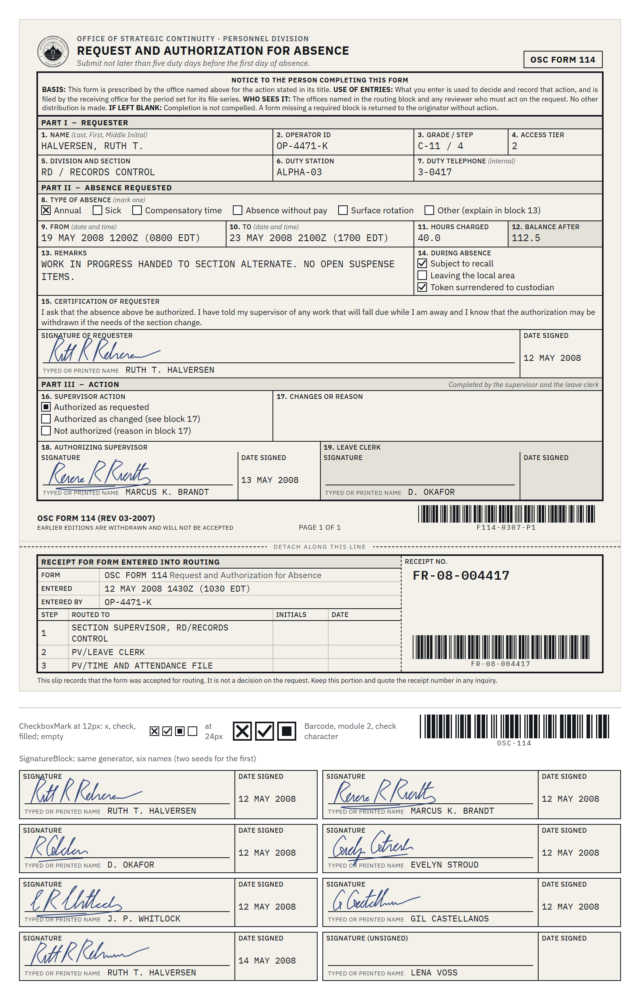

# @graphics/forms — form furniture (asset family 14)

Parts for the Forms app: the ruled skeleton of an e-form that imitates its paper
original, and the small marks that go on it. Everything is drawn in code (SVG and
ruled HTML/CSS). Colours and fonts come only from design tokens, through the alias
block at the top of `forms.css`; rules sit in the `documents` cascade layer.



## Exports (`index.tsx`)

| Export | Use |
|---|---|
| `CheckboxMark({ checked, style?: 'x'\|'check'\|'filled', size? })` | Printed box, 12-unit grid, pixel-exact at 12px. Decorative (aria-hidden). |
| `CheckItem({ checked, label, style?, onChange?, name?, disabled? })` | Box plus caption. With `onChange` it is a real, keyboard-operable checkbox. |
| `SignatureBlock({ label, name?, signed?, date?, seed?, n? })` | Ruled line, typed name beneath, date box. When `signed`, a pen signature generated from `name` + `seed`. |
| `Barcode({ value, height?, showText?, module?, ratio?, checkDigit? })` | Code 39 symbol with start/stop `*`, quiet zones, value in mono beneath. |
| `FormNumberMark({ formNo, edition, supersedes? })` | Bottom-left form identification. |
| `FormFooter({ formNo, edition, supersedes?, page?, barcode? })` | Number mark, page count, corner barcode in one row. |
| `FormSheet({ children })` | The page. |
| `FormHeader({ formNo, title, agencyLine, privacyNote?, seal?, subtitle? })` | Title block and the notice to the person completing the form. Omit `privacyNote` for the standard notice (`DEFAULT_PRIVACY_NOTE`), pass content to replace it, `false` for none. `seal` is a slot for `@graphics/seal`. |
| `FormGrid({ cols? })` | Ruled grid, 12 columns by default. |
| `FormBlock({ n?, label, children, span?, hint?, rows?, shade?, flush? })` | Numbered box with a corner label. `flush` lets a `SignatureBlock` or nested grid sit against the rules. Inputs, selects and textareas placed inside are styled as fill-in fields. |
| `FormSection({ part?, title, note? })` | Shaded band that opens a part of the form. |
| `FormValue({ children, typed? })` | An entry as filled in (mono; Courier with `typed`). |
| `ReceiptSlip({ receiptNo, formNo, submittedAt, routing, title?, submittedBy? })` | Tear-off receipt shown after submission. |
| `encodeCode39`, `layoutCode39`, `decodeCode39`, `sanitizeCode39`, `code39CheckChar`, `generateSignature` | The pure functions behind the components. |

```tsx
<FormSheet>
  <FormHeader formNo="OSC FORM 114" agencyLine="…" title="Request and Authorization for Absence" />
  <FormGrid>
    <FormSection part="PART I" title="Requester" />
    <FormBlock n={1} label="Name" hint="(Last, First, Middle Initial)" span={8}>
      <input name="name" />
    </FormBlock>
    <FormBlock n={2} label="Type of Absence" span={4}>
      <CheckItem checked={annual} onChange={setAnnual} label="Annual" />
    </FormBlock>
    <FormBlock n={3} label="Certification" flush>
      <SignatureBlock label="Signature of Requester" name={operatorName} signed={signed} date="12 MAY 2008" />
    </FormBlock>
  </FormGrid>
  <FormFooter formNo="OSC FORM 114" edition="03-2007" page="PAGE 1 OF 1" barcode="F114-0307-P1" />
</FormSheet>
```

## Notes

- **Barcode.** `value` is upper-cased and anything outside the Code 39 set
  (`0-9 A-Z - . space $ / + %`) becomes `-`; the printed text shows the value without
  the check character. Default wide:narrow ratio is 3 at a 1px module, so every bar
  lands on whole pixels. Width is 16 modules per character plus 35.
- **Signature.** Not a font. `signature.ts` builds pen strokes per word (a tall
  capital, then joined humps, loops, ascenders and descenders that shrink into a
  ripple, then a terminal flourish), shears them for slant and joins them with a
  Catmull-Rom spline. Same name and seed always give the same signature; change
  `seed` for a different hand. Ink colour is `--stamp-ink`.
- **Wording.** The header notice, the edition line and the receipt text are original;
  none is taken from a real form.
- **Sample data.** The entries in `preview.tsx` are specimens for the check, not canon.

## Checks

```
node src/graphics/forms/check/render.mjs
npx vitest run --config src/graphics/forms/check/vitest.config.ts
```

- `check/render.mjs` serves `preview.html` through Vite with the project config, takes
  the PNGs in `check/` with Playwright (2x, plus `forms-preview-1x.png`), then measures
  each rendered barcode's bars in the DOM and decodes them with a decoder of its own.
  Result in `check/barcode-readback.txt`; the script exits non-zero on any mismatch.
- `code39.test.ts` checks the pattern table against the symbology's construction rule
  (two wide bars of five, one wide space of four), round-trips the full character set
  at ratios 2, 2.5 and 3, and checks the modulo-43 character. It is outside the
  project's `tests/unit` include, hence the local config.
