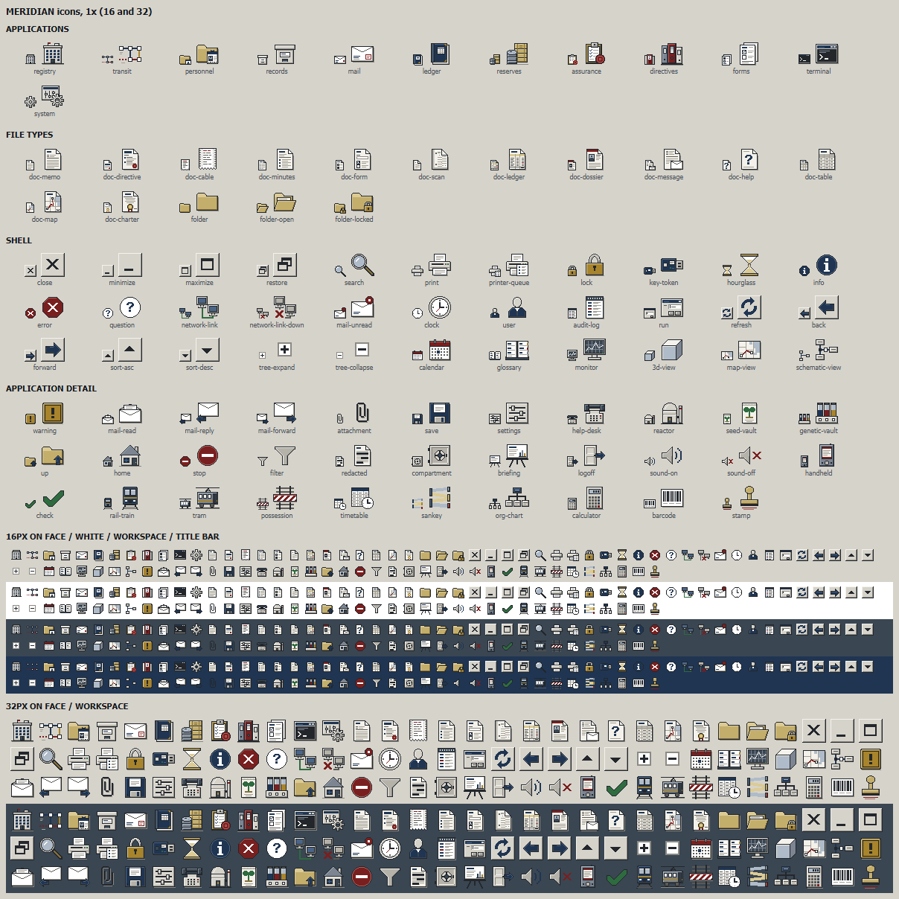
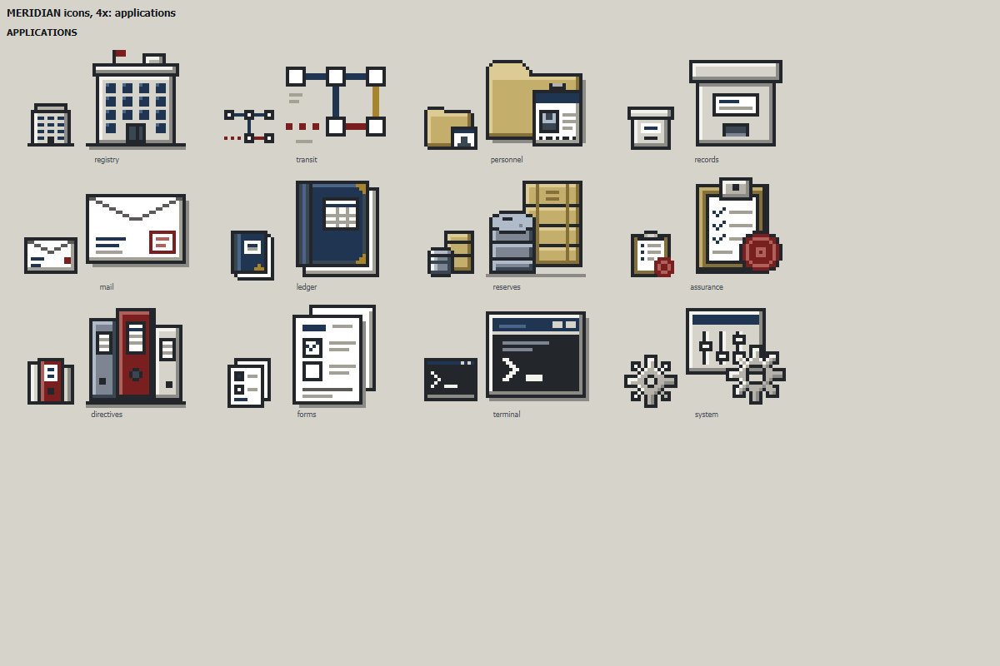
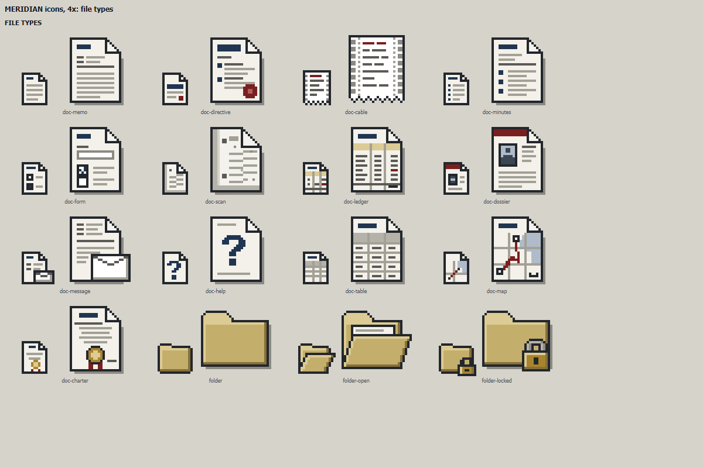
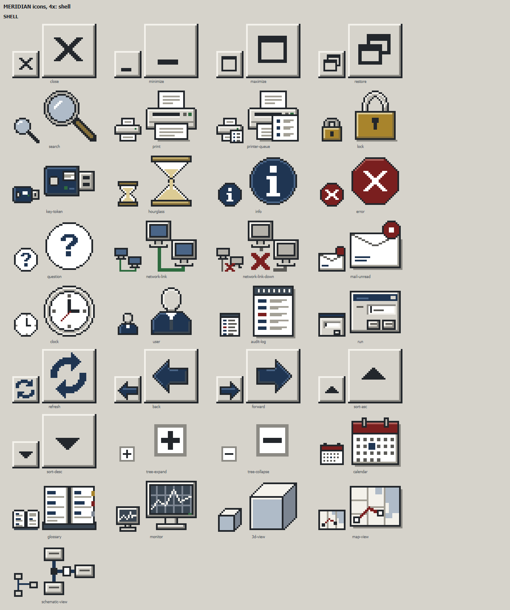
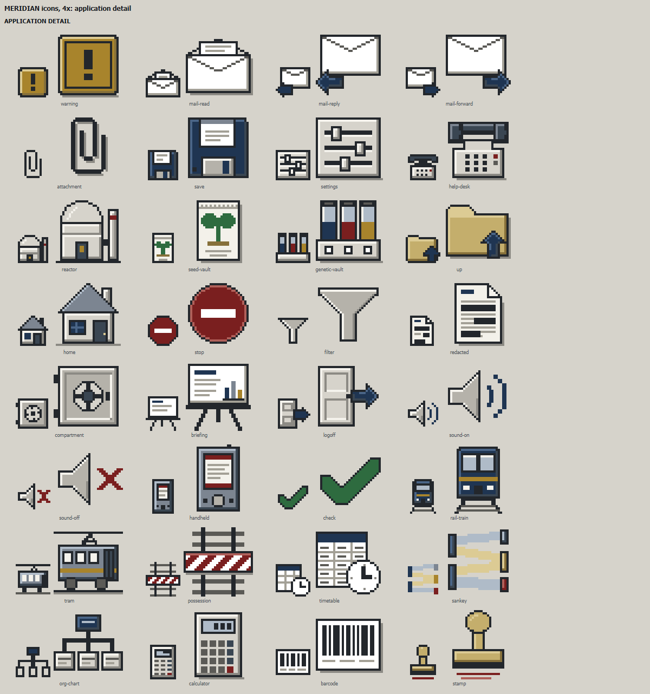
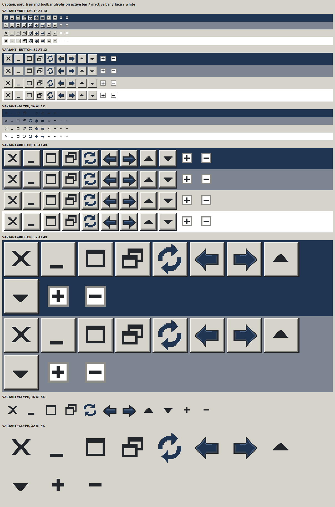

# @graphics/icons

Application, file-type and shell icons for the MERIDIAN workstation. 93 identifiers, each drawn
twice: a 16px drawing and a separate 32px drawing. The 16px version is never a reduction of the
32px one. The brief is a contractor-made Windows 2000-era enterprise set: heavy 1px outlines,
one bevel, a short muted palette.

```tsx
import { Icon, IconSprite, ICON_IDS, type IconId } from '@graphics/icons';

<Icon id="registry" size={32} />                 // decorative, aria-hidden
<Icon id="error" size={16} title="Fault" />      // named image
<Icon id="close" size={16} />                    // caption glyph on its raised button (default)
<Icon id="close" size={16} variant="glyph" />    // the bare glyph, for a button you draw yourself
<IconSprite />                                   // gallery of the whole set
```

Also exported: `APP_ICON_IDS`, `FILE_ICON_IDS`, `UI_ICON_IDS`, `MORE_ICON_IDS`, `BUTTON_ICON_IDS`,
`isIconId(id)`, `iconPaths(id, size, variant?)`, `iconSvg(id, size, scale?, variant?)` (standalone
SVG string for prerender), `ICON_PALETTE`, `type IconVariant`.

### `variant`

`close minimize maximize restore refresh back forward sort-asc sort-desc` are drawn by default as a
raised face-coloured button (white top/left edge, grey and dark bottom/right edge) carrying a dark
glyph, so they read on the active title bar, the inactive title bar, the chrome face and white.
`tree-expand tree-collapse` default to the white boxed plus/minus. `variant="glyph"` gives the bare
glyph with a transparent ground; the bare glyphs are dark or navy and must not be put on the title
bar. Every other id ignores the prop.

## Identifiers

- **Applications (12):** `registry transit personnel records mail ledger reserves assurance
  directives forms terminal system`
- **File types (16):** `doc-memo doc-directive doc-cable doc-minutes doc-form doc-scan doc-ledger
  doc-dossier doc-message doc-help doc-table doc-map doc-charter folder folder-open folder-locked`
- **Shell (33):** `close minimize maximize restore search print printer-queue lock key-token
  hourglass info error question network-link network-link-down mail-unread clock user audit-log
  run refresh back forward sort-asc sort-desc tree-expand tree-collapse calendar glossary monitor
  3d-view map-view schematic-view`
- **Application detail (32):** `warning mail-read mail-reply mail-forward attachment save settings
  help-desk reactor seed-vault genetic-vault up home stop filter redacted compartment briefing
  logoff sound-on sound-off handheld check rail-train tram possession timetable sankey org-chart
  calculator barcode stamp`

## Palette

Icons are bitmaps in spirit, so their inks are fixed here (`canvas.ts`, `PALETTE`) and not read
from CSS custom properties. Every ink is either a design token or one step from one.

| Ink | Hex | Use |
| --- | --- | --- |
| `k` | `#23272C` | outline |
| `d` | `#5B5A56` | dark grey (token: outer line) |
| `s` | `#8C8A84` | shadow (token: chrome shadow) |
| `g` | `#B5B2AA` | metal mid grey |
| `f` | `#D6D3CB` | face (token: chrome face) |
| `h` | `#F4F2EC` | highlight (token: chrome highlight) |
| `w` | `#FFFFFF` | white stock |
| `p` | `#F3F1EA` | paper (token) |
| `q` | `#A3A096` | greeked text and rules on paper |
| `n` | `#1F3552` | navy (token: active title bar) |
| `b` | `#4A6587` | navy highlight |
| `l` | `#AFBBC8` | light slate: glass, water |
| `a` | `#3A4652` | slate (token: workspace) |
| `e` | `#7C8591` | mid slate (token: inactive title) |
| `o` | `#A8842C` | ochre: brass, seals |
| `y` `m` `u` | `#DCCB94` `#C4AE6C` `#86703A` | manila highlight / body / shadow |
| `r` `t` | `#7A1F1F` `#B0605A` | oxblood and its highlight, used sparingly |
| `v` | `#2E6B3F` | dull green (token: nominal): link cable, ready lamp |

## Grid rules

1. Integer pixels only. Drawings are built on a `Cv` canvas of 16 or 32 cells; the SVG is one
   `<path>` per ink made of 1-unit-high runs, rendered with `shape-rendering="crispEdges"`. Render
   at 16 or 32 CSS px (or an integer multiple); do not scale with CSS to other sizes.
2. Every solid object has a 1px `k` outline, a 1px highlight inside the top and left edges and a
   1px shadow inside the bottom and right edges (`Cv.bx`, `Cv.bev`). No other shading, no
   gradients, no anti-aliasing. 32px drawings may add a 1px `s` drop line right and below.
3. Light comes from the top left. Objects are seen square-on; the only perspective is the turned
   page corner, the raked folder flap and the block in `3d-view`.
4. One sheet of paper (`page16`, `page32`), one folder, one envelope, one monitor, one padlock:
   shared parts live in `shapes.ts` and are reused, not redrawn differently per icon.
5. Text is greeked as 1px `q` rules; a `n` bar is a heading; oxblood marks the one thing on a
   document that matters (seal, precedence line, flagged entry).
6. Caption, sort and toolbar glyphs carry their own raised button (`shapes.ts`, `face`/`btn`):
   the button fills the 16 or 32 cell, the glyph sits inside the bevel. Their 32px glyphs are
   drawn for the size with three to four pixel strokes, not doubled from 16. See `variant` above.
   `warning` is a square ochre plate with a black bar and dot; `error` is the oxblood octagon;
   `stop` is the no-entry disc. None is a triangle.
7. No emoji, no Unicode symbols, no text glyphs from a font. The `i`, `?` and `x` are pixels.

## Files

- `canvas.ts`: pixel canvas, palette, path builder.
- `shapes.ts`: shared parts (page, folder, envelope, monitor, gear, padlock).
- `apps.ts`, `files.ts`, `ui.ts`, `more.ts`: the drawings (`s` = 16px, `l` = 32px, `sg`/`lg` = bare glyphs).
- `pixels.ts`: registry, `IconId`, `iconPaths`, `iconSvg` (no JSX, importable from scripts).
- `index.tsx`: `Icon`, `IconSprite`.

## Rendered check

```
npx tsx src/graphics/icons/check/render.ts
```

Renders every icon through Playwright Chromium at device scale 1 into `check/`:

- `check/sheet-1x.png`: all icons at 16 and 32, plus the 16px set on face, white, workspace and
  title-bar grounds and the 32px set on face and workspace.
- `check/sheet-4x-apps.png`, `check/sheet-4x-files.png`, `check/sheet-4x-ui.png`,
  `check/sheet-4x-more.png`: the same drawings at 4x (integer scale, so the result is exact
  nearest-neighbour).
- `check/sheet-buttons.png`: both variants of the caption, sort, tree and toolbar glyphs on the
  active title bar, inactive title bar, face and white, at 1x and 4x.

The matching `.html` files are the standalone pages those PNGs were captured from. The script also
fails if any 16px row is not 16 wide or uses an ink outside the palette.







