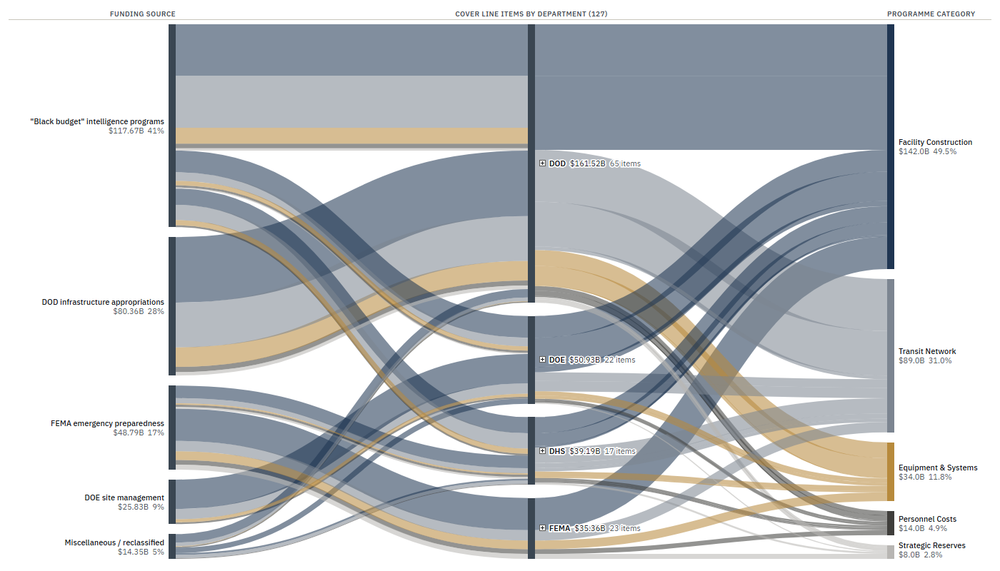
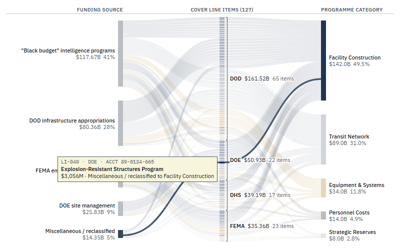
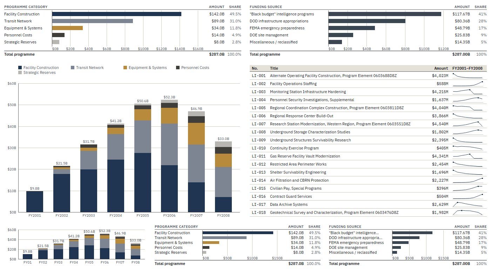

# @graphics/ledger

Budget Sankey and ledger charts (asset family 8) for the Ledger application.
The register is a 2008 financial-management report printed to PDF: flat fills,
hairline rules, small IBM Plex Sans labels with tabular figures. No gradients,
no rounded bars, no animation or transitions. Static inline SVG, so it
prerenders.

## Exports (`index.tsx`)

| Export | Props | Draws |
|---|---|---|
| `BudgetSankey` | `width, height, groupLineItems?: 'department' \| 'item' \| 'none', highlight?: NodeRef \| null, onSelect?: (ref: NodeRef) => void, defaultExpanded?: string[]` | Funding sources to cover line items to programme categories |
| `CategoryBars` | `width, height?, highlight?: categoryId, onSelect?: (id) => void` | Horizontal bars, amount and share, total row |
| `SourceBars` | same, ids are funding-source ids | Same layout for the funding sources |
| `FiscalYearChart` | `width, height, highlight?: categoryId, onSelect?: (fy) => void, legend?: boolean` | Stacked columns by category for each canon fiscal year, axis in $B |
| `LineItemSparkline` | `no, width? = 88, height? = 18` | One line item across the fiscal years, peak year marked; `null` for an unknown number |
| `CategoryLegend` | `width, highlight?` | Key for the five category fills |

Everything in `model.ts` is re-exported: `budget`, `buildSankeyGraph`,
`layoutSankey`, `nodeFlowTotals`, `fiscalYearRows`, `departmentTotals`,
`lineItemSeries`, the formatters `fmtB` / `fmtM` / `fmtMasB` / `fmtPct`, and the
types `NodeRef`, `NodeKind`, `GroupMode`.

`NodeRef` is `{ kind: 'source' | 'department' | 'item' | 'category', id }`. The
kind is needed because `DOD`, `DOE` and `FEMA` are both funding-source ids and
cover departments in canon.

## BudgetSankey behaviour

- `'department'` (default): one band per cover department with a tree expander.
  Selecting a department expands it in place to its line items (and calls
  `onSelect`); selecting it again collapses it.
- `'item'`: all 127 line items as thin bands, bracketed by department. A band,
  or either of its two flows, shows the line-item number, account, title,
  amount, source and category in a tooltip on hover or keyboard focus.
- `'none'`: sources flow straight to categories.
- Each flow is one (source, middle node, category) triple, so `highlight` (or
  hover) on any column traces exactly through the other two.
- Order is canon order in every column; line items are ordered by category,
  then source, then amount within their department. d3-sankey sets the common
  value scale and threads the flows; columns are then spaced evenly.
- Flows are coloured by programme category. Structural nodes (sources,
  departments) are slate.
- Every node is a focusable `role="button"` with an `aria-label` carrying its
  name and amount; Enter or Space activates.

## Figures

Every number is read from `canon.budget` or summed from its line items; none is
typed in this folder. Formats: categories `$142.0B`, sources `$117.67B`,
departments `$161.52B`, line items `$412M` / `$4,023M`, axes `$50B`.

## Colour

Tokens only (see the header of `ledger.css`). Five palette slots in canon
category order: `--title-active-bg` (navy), `--title-inactive-bg` (slate), a
flat `color-mix` of `--st-degraded` and `--paper-edge` (ochre),
`--chrome-dark` (charcoal), a flat mix of `--chrome-shadow` and `--surface`
(light grey). Set `--lg-bg` on a container that is not `--surface` so label
halos match the background.

## Checks

Unit test (Sankey node totals equal canon source and category totals in every
mode, flows balance through the middle column, fiscal-year sums equal canon
year totals, formats):

    npx vitest run --config src/graphics/ledger/check/vitest.config.ts

Rendered check (Vite + Playwright, headless Chromium, 1400x800 and 800x500):

    node src/graphics/ledger/check/render.mjs

Snapshots in `check/`, each at both sizes:

| File | State |
|---|---|
| `sankey-department-*.png` | default grouping |
| `sankey-expanded-*.png` | DOE expanded, source BLACK traced |
| `sankey-item-*.png` | all 127 line items |
| `sankey-item-hover-*.png` | LI-040 hovered, tooltip shown |
| `sankey-none-*.png` | no middle column, category TRANSIT traced |
| `charts-*.png` | CategoryBars, SourceBars, FiscalYearChart, sparklines in a register table, compact variants |
| `charts-selected-*.png` | same with TRANSIT selected |

`preview.html` / `preview.tsx` / `check/**` are dev-only and are not imported
by the application.
