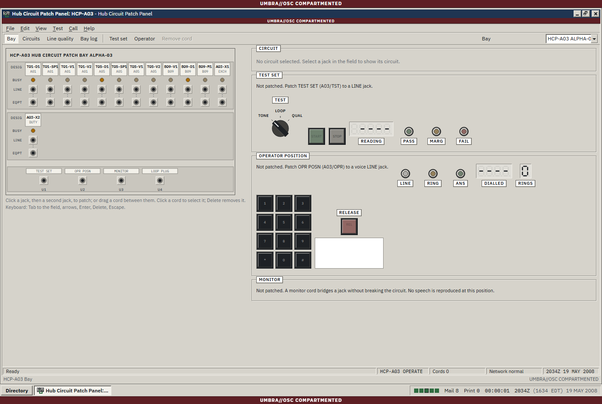

# @graphics/patch: patch bay jack field and strip chart

Drawn parts for the Hub Circuit Patch Panel (`src/apps/patch`). Both are SVG in code. Colours and fonts come only from design tokens, through the alias block at the top of `patch.css`. The parts know nothing about circuits, canon or the shared store: the app passes in plain columns, cords and values.

## Exports (`index.ts`)

| Export | Use |
|---|---|
| `JackField(props: JackFieldProps)` | A bay face. Columns of circuits are laid out in strips of `perStrip`. Each column has a designation strip (two lines, optional pencil note, masked when `withheld`), a busy lamp (`busy`, `idle`, `dark`, `test`), a dashed normal-through mark while no cord is in either jack, then the LINE and EQPT jacks. A utility strip sits underneath (TEST SET, OPR POSN, MONITOR, LOOP PLUG, or fewer). Cords are drawn as sagging curves, coloured by `CordKind`. A `flagged` cord carries its `tag` (NO ORDER). |
| `Trend(props: TrendProps)` | A strip chart of one figure over time, with dashed warning and limit lines, a min/max scale and from/to times under the axis. `live` adds a moving pen at the last value. |

### `JackField` input

| Prop | Meaning |
|---|---|
| `columns` | `{ id, jacks: [line, eqpt], lines: [l1, l2], withheld?, pencil?, lamp, normal }` |
| `utilities` | `{ id, legend }` jacks on the bottom strip |
| `cords` | `{ id, a, b, kind, flagged?, tag? }` between jack ids |
| `selectedJack`, `selectedCord` | Highlighted selection |
| `inert` | Jack ids drawn dimmed and not selectable |
| `onJack(id)` | Jack clicked or chosen with Enter/Space |
| `onDrop(a, b)` | Pointer drag from jack `a` released on jack `b` |
| `onCord(id)` | Cord clicked |
| `onDelete(jackId)`, `onEscape()` | Delete and Escape keys on the field |

The app decides what a cord means. A two-jack keyboard patch is the app's job: it keeps the first `onJack` and treats the second as the other end.

## Keyboard

The field is one tab stop with a roving focus. The arrow keys move between jacks, crossing strips and the utility strip. Enter or Space selects. Delete pulls the cord in the focused jack. Escape clears the selection. Every jack has an accessible name (circuit, side, cord state), and the lamp state is in the column's title.
