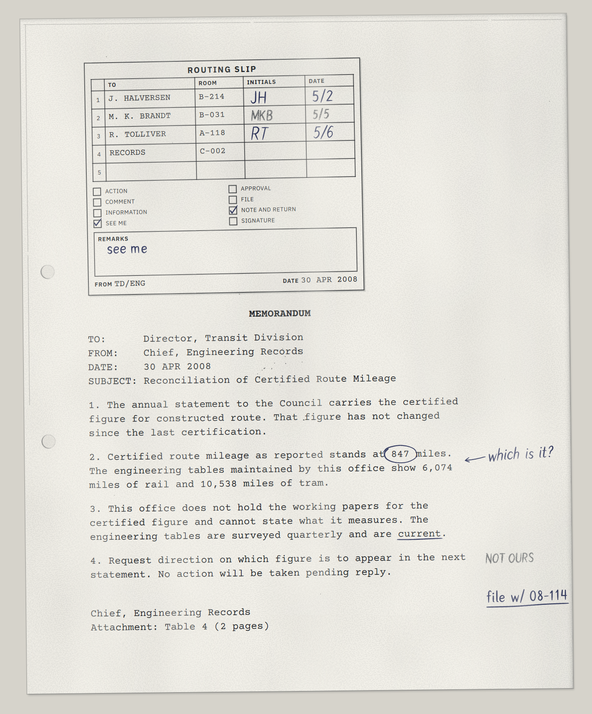
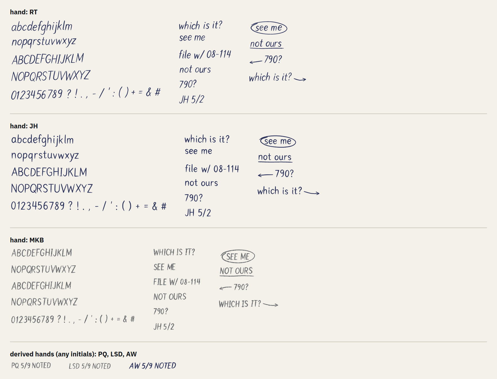

# @graphics/scan: scanned-document treatment kit

Makes a document page look like a 2008 photocopy that was later scanned into a
records system. Everything is drawn in code (SVG, CSS), deterministic from a
seed. No image files, no handwriting fonts: the handwriting is generated pen
strokes.

## Exports

| Export | Purpose |
|---|---|
| `ScanPage({ seed, rotate, children, holes?, soft?, strength? })` | Page wrapper. Children stay ordinary selectable HTML; effects are overlays. `rotate` is clamped to +/-1 degree. `soft` adds a 0.2px blur (off by default). |
| `ScanEffects`, `Toner`, `Speckle`, `CopyLine`, `EdgeShadow`, `PunchHoles({ count?: 2 \| 3, seed? })` | The individual overlays. |
| `MarginNote({ hand, seed, children, mark?, width? })` | Handwritten note as an SVG path. `mark`: `underline`, `circle`, `arrow-left`, `arrow-right`. |
| `RoutingInitials({ initials, seed, hand? })` | e.g. `"JH 5/2"`, written in that person's hand. |
| `RoutingSlip({ entries, actions?, remarks?, from?, date?, seed? })` | Routing slip: TO / ROOM / INITIALS / DATE, typed entries in `var(--font-typed)`, handwritten initials, ticks and remarks. |
| `Handwriting({ text, hand, seed, size?, maxWidth?, mark?, inline? })` | Any text in a hand. |
| `InkCircle`, `InkUnderline`, `InkArrow` | Pen marks to lay over typed text (absolutely positioned). |
| `enhanceScans(root): () => void` | Upgrades pipeline HTML in a mounted document. Idempotent; returns a dispose function. |
| `composeInk`, `writeText`, `inkPath`, `handStyle`, `GLYPHS` | The pure pen engine, usable without Preact. |

`index.ts` imports `scan.css`. Code that runs outside Vite (for example a Node
prerender) can import the component files directly and link the CSS itself.

## Pipeline HTML that `enhanceScans` reads

```html
<div class="scan-page" data-seed="7" data-rotate="-0.6">        <!-- optional data-holes="0|2|3" -->
  <div class="routing-slip" data-initials="JH,MKB"></div>
  <aside class="margin-note" data-hand="RT" data-seed="3">which is it?</aside>
</div>
```

Optional extras, all additive to docs/CONTRACTS.md:

- `.margin-note[data-mark]` (`underline | circle | arrow-left | arrow-right`), `[data-width]`.
- `.routing-slip[data-initials]` items may carry a date: `"JH 5/2,MKB 5/5"`. Otherwise the date comes
  from `data-date` (ISO or literal) or from a `.stamp[data-date]` in the same page. Also `data-actions`
  (`"FILE,SEE ME"`), `data-remarks`, `data-from`.
- `[data-ink="circle|underline"]` on an inline element draws a pen mark over it (measured after layout).

Without script the page still reads correctly: a margin note is italic text in
ink colour, a routing slip is a typed `ROUTING: JH,MKB` line. After enhancement
each note keeps its words as visually hidden text for search, copy and screen
readers.

## Handwriting

`glyphs.ts` is a hand-authored single-stroke alphabet (a-z, A-Z, 0-9 and
`? ! . , - / ' : ( ) + = & #`) as point lists per stroke. `pen.ts` jitters every
point, applies slant, baseline wander and per-glyph scale, smooths the strokes
(Catmull-Rom, with hard corners where the data repeats a point) and builds a
filled outline whose width follows pressure: heavier on downstrokes, tapering
at entry and exit.

Hands: `RT` (quick right-leaning ballpoint), `JH` (upright, tidy ballpoint),
`MKB` (pencil block capitals). Any other initials get a stable hand derived
from the name. Ink colours are `--ink-ballpoint` and `--ink-pencil` in
`scan.css`; everything else uses design tokens (`--paper`, `--text-1`,
`--font-typed`).

## Honesty test

A decent office copier, not a prop: uneven toner is low-contrast vertical
banding plus fine grain, one long edge copied grey, two punch-hole shadows, a
few specks, and sometimes the faint skewed edge line of an earlier-generation
copy. No stains, tears, burns or folds, and no `Stain` export.

## Rendered check

```
node src/graphics/scan/check/render.mjs     # from the repo root; writes check/*.png
npx vite --port 5391                        # then open /src/graphics/scan/preview.html
```

- `check/memo.png`: `ScanPage` with routing slip, "which is it?" beside the circled 847, and notes in three hands.
- `check/memo-847-detail.png`: close-up of that note.
- `check/pipeline.png`: raw pipeline-shaped HTML upgraded by `enhanceScans`.
- `check/slip.png`: `RoutingSlip` on its own.
- `check/alphabet.png`: full alphabet sheet and test phrases for each hand.



